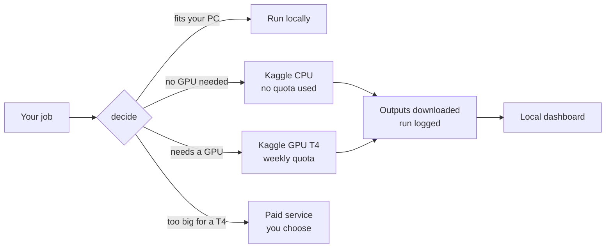
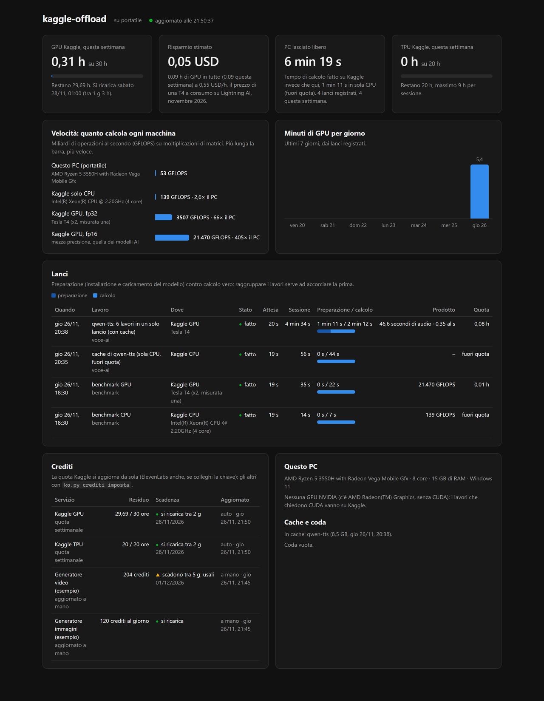

<div align="center">

# kaggle-offload

**Run heavy AI jobs on Kaggle's free GPUs when your own machine can't, and see exactly what you use.**

A skill for [Claude Code](https://claude.com/claude-code) · about 30 free GPU hours every week · no GPU needed on your PC

[](LICENSE)


[Quick start](#quick-start) · [How it works](#how-it-works) · [Templates](#templates) · [Contributing](CONTRIBUTING.md)

<br>


</div>

## Why

Kaggle gives anyone with a verified phone number **about 30 hours of NVIDIA Tesla T4 time every week, for free**. It is not a one-month trial: the quota refills every week. Most people don't know, and leave AI jobs crawling on their laptop's CPU for hours.

This skill was born on a laptop with a Ryzen 5, 16 GB of RAM and integrated graphics: no NVIDIA GPU, so no CUDA, which nearly all open-source AI runs on. A text-to-speech model wouldn't even start. The same job on Kaggle produced six audio clips in 5 minutes 20 seconds, at no cost. kaggle-offload turns that one-off experiment into a routine: it decides where a job should run, runs it, and keeps count. The whole story, with real numbers, is in [`DEVLOG.md`](DEVLOG.md).

## What it does

- **Decides where a job should run**: on your PC, on Kaggle CPU (no quota used), on a Kaggle GPU or TPU, or it tells you a paid service would be needed. It looks at your hardware, the memory the model needs and the quota you have left.
- **Runs it on Kaggle and waits**, then downloads the outputs and logs everything: queue time, session length, quota used, setup time versus compute time.
- **Batches similar jobs** into a single run, so installing packages and loading the model are paid once.
- **Caches packages and model weights on Kaggle**, built on CPU only. On the same batch, setup time went from 97 to 71 seconds.
- **Benchmarks** your PC against Kaggle CPU and GPU with the same computation.
- **Tracks your credits** across AI services, with expiry dates, so none go to waste.
- **Shows it all on a local dashboard**: weekly quota, running jobs with a live timer, speed, estimated savings, credits.

## How it works



Jobs are pushed as private Kaggle kernels through the official Kaggle CLI. Your token stays where you put it: the skill never reads it.

## Quick start

You need Python 3 and a Kaggle account. `ko.py` uses only the standard library plus the Kaggle CLI.

**As a plugin** (Claude Code 2.1.275 or later), in a Claude Code session:

```
/plugin install kaggle-offload --marketplace fracabu/green-compute
```

It comes from the [green-compute](https://github.com/fracabu/green-compute) marketplace, which also bundles kaggle-offload with [token-diet](https://github.com/fracabu/token-diet) and [or-switch](https://github.com/fracabu/or-switch). Choose the user scope to have it in every project: until a job calls for it, it costs only its one-paragraph description in the context.

**Or as a personal skill**, with git:

```bash
git clone https://github.com/fracabu/kaggle-offload ~/.claude/skills/kaggle-offload
```

Then, once:

1. `pip install kaggle`.
2. Sign up at [kaggle.com](https://www.kaggle.com) and **verify your phone number** in your account settings. Without it, GPUs and internet access stay off in notebooks.
3. In your account settings, create an API token and place it where Kaggle tells you (`~/.kaggle/`).
4. Ask Claude *"is kaggle-offload ready?"*, or run `python scripts/ko.py setup` from the skill's folder. If it answers `"ready": true`, you're set.

Tested on Windows 11. The code is meant to work on macOS and Linux too, but it hasn't been tested there yet: if you try it, please open an issue.

## Usage

**With Claude Code**, just ask: *"run this on Kaggle"*, *"it won't start on my PC"*, *"this is taking forever on the CPU"*, *"how much GPU quota do I have left?"*. The skill also steps in on its own when an AI job is about to run on a machine without an NVIDIA GPU. Instructions for Claude are in [`SKILL.md`](SKILL.md).

**From the command line**, with `ko.py` in `scripts/`:

| Command | What it does |
|---|---|
| `ko.py open` | start the dashboard and open it in your browser |
| `ko.py setup` | check the CLI, token, quota and hardware |
| `ko.py decide --vram 8 --hours 0.5` | where a GPU job should run |
| `ko.py decide --cpu-only --hours 2` | the same for a CPU-only job |
| `ko.py run --template qwen-tts --jobs jobs.json` | run a template |
| `ko.py run --script my_job.py --acc gpu` | run your own script |
| `ko.py queue add qwen-tts --file jobs.json` · `ko.py queue launch qwen-tts` | batch jobs and run them together |
| `ko.py cache qwen-tts` | build a template's cache on Kaggle (CPU only) |
| `ko.py bench` | benchmark your PC against Kaggle CPU and GPU |
| `ko.py credits` · `ko.py credits set ...` | credits across services |
| `ko.py quota` | this week's Kaggle quota |

## The dashboard

`ko.py open` serves a single-page dashboard on `127.0.0.1`, starting from port 8790. It refreshes every few seconds and works in light and dark mode.



The "savings" figure is an equivalence: GPU hours times the on-demand price of a T4 on a cloud service. It isn't money you actually saved if you wouldn't have run the job otherwise.

## Templates

A template is a job already tested on Kaggle, ready to run again in batches: a folder in `templates/` with `main.py` and `template.json`.

| Template | What it does | Status |
|---|---|---|
| `bench` | GFLOPS benchmark on CPU and GPU | tested |
| `cache` | stores another template's pip packages and Hugging Face weights on Kaggle | tested |
| `qwen-tts` | Qwen3-TTS 1.7B: voices designed from a description, and voice clones | tested |

Many useful models are still missing: Whisper, SDXL and Flux, LoRA training, upscaling, a small LLM for batch text work. **A new template is the easiest way to contribute**: see [`CONTRIBUTING.md`](CONTRIBUTING.md).

## What fits on a T4

A session gives you up to two Tesla T4 cards with 16 GB each and about 30 GB of RAM. Rule of thumb for model weights: about 2 GB per billion parameters in fp16, 1 GB in 8-bit, 0.6 GB in 4-bit, plus 20-30% headroom.

| Job | Examples | On a T4 |
|---|---|---|
| Speech to text | Whisper large-v3, large-v3-turbo | great fit |
| Text to speech | Qwen3-TTS (tested), Kokoro, XTTS | great fit |
| Text models | Qwen3, Llama 3.1, Gemma 3, Mistral | up to ~8B comfortably; 14B and beyond quantized, split across both cards |
| Images | SDXL, SD 3.5 Medium | good; Flux only quantized, and slow |
| Fine-tuning | LoRA on SDXL | doable with low-memory settings |
| Video | Wan 2.2 5B, LTX-Video | short clips, slowly; larger models are borderline |

The T4 dates from 2018: no bf16 and no FlashAttention 2, so recent models run in fp16. Only the TTS row has been tested with this skill so far; the rest are estimates.

## Privacy and limits

- Your code and data go through Kaggle's (Google's) servers. Kernels are private, but **don't send personal or confidential data**. If you need privacy, the model has to run on your own machine.
- GPU quota is about 30 hours a week (`ko.py quota` shows the exact figure and refill date), TPU 20 hours. Sessions last up to 12 hours (9 on TPU).
- Quota is counted from the moment a session starts, setup included. That's why the skill batches jobs.
- The skill's own data (run log, quota, credits, benchmarks) lives in `~/.kaggle-offload/` on your machine, never in the repo.

## Contributing

New templates, tests on macOS and Linux, fixes and ideas are all welcome. Start with [`CONTRIBUTING.md`](CONTRIBUTING.md).

## License

[MIT](LICENSE) · made by [@fracabu](https://github.com/fracabu)
